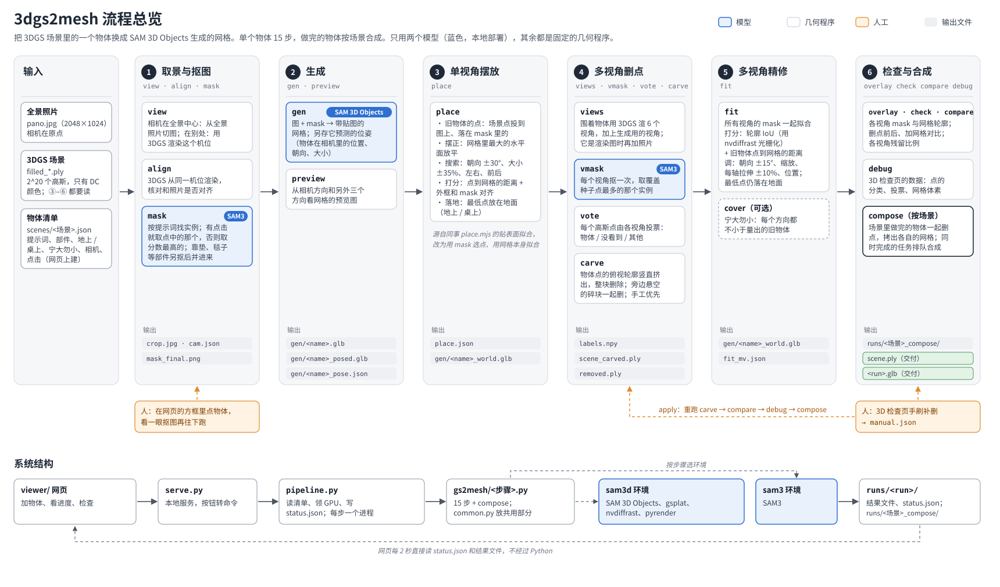

# 3dgs2mesh

把 3DGS 场景里的物体换成 [SAM 3D Objects](https://github.com/facebookresearch/sam-3d-objects) 生成的网格。

- **输入**：一张全景照片、同一个房间的 3DGS（`filled_*.ply`），以及要换哪个物体（提示词，或者在图上点一下）。
- **输出**：删掉旧物体的 3DGS（`scene.ply`），加上每个物体的网格（`.glb`）。网格的坐标和 3DGS 对齐，可以直接摆在一起。

整个流程只用两个模型，都部署在本机：SAM3 负责抠图，SAM 3D Objects 负责生成网格。其余步骤（摆放、删点、精修、检查）都是固定的几何程序，不用 agent，也不调外部服务。



## 目录

```
pipeline.py          唯一入口：读清单、领 GPU、按步骤起进程、写 status.json
gs2mesh/             每一步一个模块（run(c)），common.py 放共用部分（读写/渲染 3DGS、相机、SAM3）
scenes/index.json    场景列表：id、3DGS 文件、全景照片
scenes/<场景>.json   这个场景要换的物体（物体清单）
viewer/              网页：加物体、看进度、3D 检查、手工补删（serve.py 是本地服务）
docs/pipeline.svg    上面那张流程图
runs/                结果（不进 git）：runs/<run>/ 是单个物体，runs/<场景>_compose/ 是合成后的场景
物品摆放测试/         场景数据（不进 git）
```

## 环境

需要一台 Linux 机器，一张 24 GB 显卡（生成那一步用约 22 GB），CUDA 12.8。另外要两个 conda 环境，路径写在 `pipeline.py` 的 `ENV` 里：

| 环境 | Python | 装了什么 | 权重 |
|---|---|---|---|
| `sam3d` | 3.11 | SAM 3D Objects、gsplat、nvdiffrast、pyrender、trimesh、plyfile、scipy、opencv | `~/sam3d/sam-3d-objects/checkpoints/hf`（约 13 GB） |
| `sam3` | 3.12 | SAM3、opencv | `~/sam3d/sam3/checkpoints/sam3.pt`（约 3.3 GB） |

`pipeline.py` 自己只用标准库，任何 python3 都能跑。每一步会在对应的环境里另起一个进程。领卡的方式和 sam3d 流水线一样：整个任务期间锁住 `/tmp/outdoor_pipeline_gpu<N>.lock`，按这次要跑的步骤里显存要求最高的那个来挑卡。

## 用法

```bash
./pipeline.py steps                                   # 列出 15 个步骤
./pipeline.py new A01 '{"name": "chair", "prompt": "wooden chair", "cam": {"yaw": -60, "pitch": -20, "fov": 70}}'
                                                      # 加一个物体，打印 {"run": "A01_chair"}
./pipeline.py run A01_chair --steps view,mask         # 先抠图，看一眼 runs/A01_chair/overlay_final.jpg
./pipeline.py run A01_chair --from gen                # 没问题就跑完剩下的，跑完自动重新合成 A01
./pipeline.py set A01_chair '{"rest": "table"}'       # 改字段，然后从 place 重跑：run A01_chair --from place
./pipeline.py apply A01_chair                         # 检查页手工补删后：重算删点、对比、检查页数据，再合成
./pipeline.py compose A01                             # 只重新合成场景
./pipeline.py remove A01_chair                        # 从清单去掉（目录保留），再合成
```

`run` 不加参数时跑全部步骤。`--seed N` 用另一个种子重新生成，种子会记进清单。同一个物体正在跑时，再起一次会直接报错退出。

### 物体清单的字段（`scenes/<场景>.json`）

| 字段 | 意思 |
|---|---|
| `run` | 结果目录名，`new` 时自动起（`<场景>_<name>`，重名就加 `_2`） |
| `name` | 英文名，用在文件名里（`gen/<name>.glb`） |
| `label` | 中文显示名，可以空 |
| `prompt` | SAM3 提示词（英文），例如 `green armchair` |
| `parts` | 压在物体上、要一起换掉的东西，例如 `["pillow", "blanket"]` |
| `rest` | `floor` 在地上 / `table` 在桌上；挂墙的还不支持 |
| `cover` | 宁大勿小：精修时网格在每个方向都不小于旧物体 |
| `cam` | 生成用的相机：`{C, Rb, f, size}`；命令行也可以写 `{yaw, pitch, fov}`，表示从全景中心转过去 |
| `click` | 在这张图上点的像素 `[u, v]`；有的话，抠图就选点中的那个实例 |

相机在全景中心（`C = 0`）时，生成用的图直接从全景照片切出来；在别的位置时，就用 3DGS 渲染出这个机位的图。全景中心看物体太俯视的时候（比如 A01 的茶几），就得换到别的机位。

### 进度：`runs/<run>/status.json`

```json
{"state": "running", "step": "gen", "i": 3, "n": 15, "steps": [...], "gpu": 1, "pid": 12345, "error": null, "updated": "..."}
```

- `state` 有四种：`queued`（在等卡）、`running`、`done`、`failed`。
- `i` 是已经完成的步数。
- 失败时，`error` 里是报错的最后几行。
- 给 `pid` 发 SIGTERM 可以停止任务，状态会写成 `failed` / `已停止`。

合成目录 `runs/<场景>_compose/` 里也有一个 `status.json`。

## 步骤

| # | 步骤 | 做什么 | 主要输出 | 耗时* |
|---|---|---|---|---|
| 1 | view | 生成用的图：在全景中心就从照片切，在别处就用 3DGS 渲染 | `crop.jpg`, `cam.json` | <3 s |
| 2 | align | 3DGS 从同一机位渲染，和照片并排，核对是否对齐（只对照片切图做） | `check_align.jpg` | 3 s |
| 3 | mask | **SAM3**：按提示词（或点击）选实例，再把部件并进来 | `mask_final.png`, `overlay_final.jpg` | 20 s |
| 4 | gen | **SAM 3D Objects**：生成带贴图的网格，另存它预测的位姿 | `gen/<name>.glb`, `gen/<name>_posed.glb` | 2–3 min |
| 5 | preview | 从四个方向看网格 | `gen/<name>_preview.jpg` | 2 s |
| 6 | place | 单视角摆放：落在 mask 里的场景点就是旧物体；把网格摆正，搜索朝向、大小和位置，最低点落到地面 | `place.json`, `gen/<name>_world.glb` | 5 s |
| 7 | views | 用 3DGS 围着物体渲 6 个视角，加上生成用的视角；生成用的是渲染图时，再加一张全景照片 | `views/` | 4 s |
| 8 | vmask | **SAM3**：每个视角抠一次 | `views/<k>/mask.png` | 20–30 s |
| 9 | vote | 每个高斯点由各视角投票，分成物体 / 没看到 / 其他 | `labels.npy` | 1 s |
| 10 | carve | 把物体点的俯视轮廓竖直挤出、整块删除，悬空碎块一起删，手工修正优先 | `scene_carved.ply`, `removed.ply` | 1 s |
| 11 | fit | 用所有视角的轮廓精修网格：朝向 ±15°、缩放、每轴拉伸 ±10%；`cover` 时宁大勿小 | `gen/<name>_world.glb`, `fit_mv.json` | 6 s |
| 12 | overlay | 每个视角画出 mask 轮廓和网格轮廓 | `views_overlay.jpg` | 2 s |
| 13 | check | 删点前、删点后、删点后加网格，从三个机位看 | `check.jpg`, `check.json` | 6 s |
| 14 | compare | 每个视角：原样 / 删后 / 删掉的点，以及残留比例 | `views/<k>/cmp_*.jpg`, `compare.json` | 4 s |
| 15 | debug | 3D 检查页（`viewer/debug.html`）用的数据 | `debug/` | 5 s |

\* A01 沙发、茶几，单张 3090 上的实测。一个物体从头到尾大约 4 分钟，大部分时间在生成。

合成（`compose`）：把场景里所有做完的物体一起删点，网格拷成 `<run>.glb`，再写出 `scene.ply`、`scene.splat`（给网页用）、`orig.splat` 和 `objects.json`。

## 坐标

用 OpenCV 世界坐标系：x 向右，y 向下，z 向前。全景相机在原点，yaw 0 是全景图的正中间。3DGS 的单位不是米，全景相机离地大约 0.5。`place.json` 里的 `posed_to_world` 和 `glb_to_world` 记录了网格变换到 3DGS 坐标系的矩阵。

## 网页

```bash
/home/ubuntu/miniforge3/envs/sam3d/bin/python viewer/serve.py 8791    # 只监听 127.0.0.1
```

打开 `http://127.0.0.1:8791/viewer/`。页面直接读 `scenes/` 和 `runs/` 里的文件，按钮通过 serve.py 调用 `pipeline.py`。

## 已知问题

- 生成不是完全确定的：种子相同，两次生成的网格也会有细微差别（位姿一样）。从生成之后开始重跑是确定的。
- 所有视角都在全景相机这一侧，物体背面看不到，所以量出来的进深偏小，背面删得干不干净也没法检查。
- 挂在墙上的物体（`rest` 只能填 floor 或 table）还不支持；自动找物体也还没做。

## 来源

- `gs2mesh/place.py` 的摆放思路和常数来自同事的 `place.mjs`（贴表面拟合，这个仓库里没有附原文件）。改动写在 place.py 开头的注释里。
- `viewer/lib/` 里是 three.js 和 [GaussianSplats3D](https://github.com/mkkellogg/GaussianSplats3D)，都是 MIT 许可。
